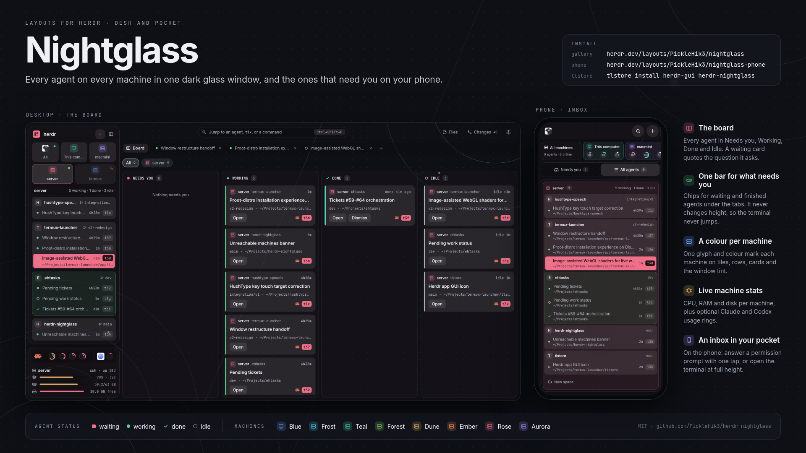

# Nightglass

Two dark glass layouts for [Herdr](https://herdr.dev): one for the desk, one for your pocket.



- **Desktop:** every machine and agent in the sidebar, one fixed bar under the tabs for what needs you, and a **Board** that lays every agent out in Needs you, Working, Done and Idle, quoting the question each waiting agent asks.
- **Phone:** an inbox of the agents that need you; answer a permission prompt with one tap or open the terminal at full height.
- **One colour per machine:** a machine's glyph and colour mark it on tiles, rows, cards and the window tint.

## Install

Inside Herdr, ask your agent:

```
Read ~/.config/herdr-app/AGENTS.md, then add this layout: herdr.dev/layouts/PickleHik3/nightglass
```

For the phone layout, use `herdr.dev/layouts/PickleHik3/nightglass-phone` instead.

To install by hand, copy the `layouts/`, `mods/` and `themes/` folders from `nightglass/` (or from `nightglass-phone/`) into `~/.config/herdr-app/`. Then run `herdr-app do layout.switch --name nightglass` (or `--name nightglass-phone`). The desktop layout needs herdr-app 0.1.16 or newer. Updating an older copy: copy `layouts/nightglass.json` again (or add its `board` block to your `main-stack`) to get the Board pill.

**Usage rings (optional).** Usage rings are off by default. To show them, add `"usage": "<machine>"` to the props of the sidebar block (desktop) or the inbox block (phone), naming the machine that runs `~/.local/bin/ai-usage-tui`.

**Layout cycle.** `mods/layout-cycle/` makes `ctrl-shift-l` switch between `nightglass`, `nightglass-phone` and Herdr's `main` only. Bind it in `keys.json` with `"ctrl-shift-l": "mod.open:layout-cycle"`.

## On your phone

The phone layout was designed specifically for [Termux Launcher](https://github.com/PickleHik3/termux-launcher). Termux Launcher is based on Termux and has a built-in X11 display, which is where the Herdr desktop app's window shows up. Install the app and both layouts with [tlstore](https://github.com/PickleHik3/tlstore):

```sh
tlstore install herdr-gui herdr-nightglass
herdr-nightglass            # copy the layouts into ~/.config/herdr-app
herdr-nightglass phone      # switch to the phone layout (or: herdr-nightglass desktop)
```

Before the first start, open Settings > Linux apps > Graphics acceleration and run the benchmark once. After that, open **Herdr** from the app drawer, or run `herdr-app`. `ctrl-shift-l` switches layouts.

The store's build of Herdr also puts notifications at the top of the terminal and keeps popups inside the narrow window. Other builds show notifications in the bottom right, and popups can run past the edge.

## Development

The root `layouts/`, `mods/` and `themes/` folders are the source. `nightglass/` and `nightglass-phone/` are the copies the gallery installs from, each with a `RECIPE.md` that describes the layout in full. To keep them in step:
- After any change, run `scripts/sync-gallery.sh`. `--check` reports drift.
- Run `node scripts/check-phone.mjs` to check the phone mod. It fails if the phone mod's copies of `lib.js` and `data.js` drift from the desktop mod's.

The design files are in `design/`.

MIT licence. The palette started from Tokyo Night by enkia. The Board follows the idea of the `board` layout in [jkuepker/herdr-layouts](https://github.com/jkuepker/herdr-layouts) (MIT), rebuilt on Herdr's own agent states.
