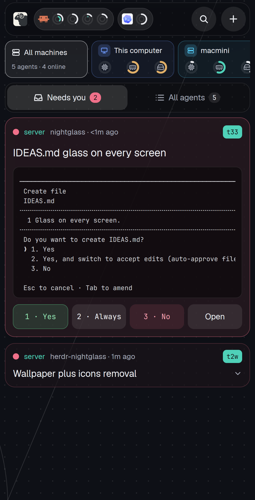

# Nightglass Phone

The Nightglass glass look for Herdr on a portrait phone screen. It opens on an inbox of the agents that need you: a header row, a sideways row of machine tiles, and a Needs you / All agents switch. A card answers a permission prompt or a question with one tap; Open shows that terminal at full height with a message box and a Files / Changes sheet. It is drawn for a 412 px wide screen, shares the wallpaper, icons and ten colour themes of the desktop Nightglass layout (so this folder carries `mods/nightglass/` too), and was tested on herdr-app 0.1.13 in Termux on Android.

## What you see

Window: `titlebar: none`, not resizable, wallpaper `mods/nightglass/wallpaper.png` (`cover`; near-black `#0e1016` with a faint dot grid), UI font Inter, terminal font JetBrains Mono at size 8 (neither is bundled), terminal padding 10 px vertical and 12 px horizontal, terminal opacity 0.82. Base theme `nightglass`: canvas `#0e1016`, chrome `#0c0d12`, surface `#0d0e13`, text `#eceef2`, muted `#a8adba`, accent `#e6e7eb`, working/done `#5fd38d`, blocked `#f0708a`, amber `#e0af68`, teal `#4fd1b8`. Body text is 13 px. Every size below is in designed px at zoom 1.

The home view (the `inbox` block fills the screen), top to bottom:

1. **Header**, one glass box (16 px radius, 1 px rim, shadow): Herdr's logo, a room for the usage wells (empty unless the `usage` prop is set), a 40 px round search button and a 40 px round `+` button.
2. **Machine tiles**, a sideways-scrolling row of 134 x 60 px tiles (12 px radius): **All machines** first (`N agents · M online`), then one per machine, tinted in its colour, with a glyph (a monitor for "This computer", a server otherwise), its name and small rings for cpu, ram and disk. The selected tile is stronger and has a brighter rim.
3. **Tabs**, a 48 px well with two 40 px segments: `Needs you` (count; the count chip is red when something waits) and `All agents` (count).
4. **Body**.
   - Needs you: one card per waiting or finished agent (16 px radius, 12 px padding). The first (or the tapped) one is expanded, the others collapse to a top row and the title. A card starts with a status dot (10 px; red `#f0708a` waiting, green `#5fd38d` finished), the machine name in its colour, space and age (`12m ago`) and a terminal chip (`t3`) in the machine colour; then the title, a terminal excerpt (up to 212 px high, shorter on a short window) in mono, and a row of 40 px buttons: for a permission prompt `Yes`, `Always`, `No`; for a question one numbered row per option with its description; always `Open`, and on a finished card `Dismiss`.
   - Nothing waiting: a green check, "Nothing needs you", the real counts (`All: 3 working · 1 idle`), a `See all agents` button, and a "Finished" list of finished agents you already dismissed.
   - All agents: the agents grouped by machine, then by space capsule, one row per agent with status mark, title and age, and a new-space row per machine.

The detail view (after Open or a tap on a row), top to bottom: a 60 px bar (an `Inbox` back button, agent name and terminal number, Files and Changes buttons), the terminal at full height in a 12 px radius pane with a 1 px border and a `#ffffff40` focus border, a Files / Changes sheet when open (a 52 px head over the shipped `files` or `changes` mod; the sheet has weight 1.5 against the terminal's 1), and a 44 px composer (prompt field and send button) bound to that terminal.

Machine colours (eight schemes, each a theme): Blue `#6e9bff`, Frost `#52c6f0`, Teal `#4fd1b8`, Forest `#86d46a`, Dune `#e5b45c`, Ember `#f58f5c`, Rose `#f0708a`, Aurora `#a98bf5`. A machine with no pick is Blue; the All view uses the neutral `nightglass-storm`.

Toasts (through `nightglass-toast`): a one-line capsule, 380 x 32 px, at the top of the terminal, 6 px gap, two at most.

## How it behaves

- Tap a machine tile: filters everything to that machine. Tap All machines: all of them. Tap the selected machine's tile again: a popup of the eight colour swatches; the pick is stored under the shared key `nightglass.colors`.
- The window takes the focused machine's theme (`app.theme`, checked every 500 ms), or `nightglass-storm` in the All view.
- Tapping a collapsed card expands it.
- Answers: the card reads the screen with `hc read` (only the card shown, every 2.5 s, last 60 lines) and finds a numbered dialog (`1. Yes`, `2. Yes, and don't ask again`, `3. No`). Yes / Always / No and a question's rows press the digit with `hc keys <terminal> <n>`. A failure raises a warning toast ("Not answered: t3").
- Open: `agent.focus` (or `space.select`, `tab.select`, `pane.focus` for a plain terminal), hides the inbox and shows the bar, terminal and composer. Back (`layout.show` of the inbox) returns. Files and Changes in the bar open the sheet (`layout.select` and `layout.show`; `layout.hide` to close).
- Composer: `hc send <terminal> <text>` (pastes and presses Enter; Herdr refuses a terminal blocked on a dialog). It is bound to the terminal it was opened for: if another terminal is in front at send time nothing is sent, the text stays and the row turns amber ("tNN is no longer in front, tap to retarget").
- `+` in the header: rows for Space (`space.new` on the machine), Terminal (`tab.new`), Files and Changes (`tab.new` of the shipped mods), Settings (`app.settings`) and one chip per agent installed on a machine (`tab.new` or `space.new` with that agent's argv).
- Search runs `app.palette`.
- Stats: cpu, ram and disk for every reachable machine, one read per machine every 15 s (60 s retry after a failure). Git changes of the focused space come from `git status --porcelain` and show as a count on Changes.
- Finished agents stay in Needs you until dismissed or opened; a later finish shows again.
- Zoom: with the `fit_zoom` prop (on in this layout) the inbox steps the app zoom with `app.zoom_in` / `app.zoom_out`, one 0.1 step per 400 ms, until it is within 0.05 of window width / 412 (clamped 0.5 to 3, at most 30 steps), then stops until the layout is loaded again.

## Built from

`layouts/nightglass-phone.json`: a root row with `toast: "nightglass-toast"`, `theme: "nightglass"`, `background`, `resizable: false`, `terminal_padding: [10, 12]`, `terminal_opacity: 0.82`, `preview: "layouts/nightglass-phone.svg"`, `ui_font`, `font`, `font_size: 8`, and `toasts` (`over: "term"`, `anchor: "top-center"`, `offset: 8`, `width: 380`, `height: 32`, `gap: 6`, `max: 2`). One column `phone` holds a column `core` (gap 6) of: block `inbox` (role `inbox`, `props.fit_zoom: true`), hidden block `dbar` (60 px, role `dbar`), hidden column `term` (weight 1, 8 px side padding, block `main` with `tab: active` and pane options radius 12, background `surface`, `lone`, 1 px `border`, focus 1 px `#ffffff40`), hidden column `sheet` (weight 1.5; block `sheethead` 52 px, role `sheet`; stack `sheet-body`, active `files`, radius 12, with blocks `files` and `changes`), hidden block `composer` (44 px, role `composer`).

`mods/nightglass-phone/` (one mod, `place: none`, roles by `props.role`): `main.js` (roles `inbox`, `dbar`, `sheet`, `composer`, `usage`, `colors`; state, timers, fit_zoom, the machine theme), `inbox.js` (home view), `detail.js` (bar and sheet head), `composer.js`, `newmenu.js` (the `+` rows), `polls.js` (git changes, stats, usage, terminal text, dialog parsing), `phone.js` (zoom, window size, swipe areas, popups, dismissal), `lib.js` and `data.js` (verbatim copies of the desktop mod's), `inbox.svg`, `list.svg`, `arrow-up.svg`, two chevrons, and 20 + 20 small ring arcs (`ring-s-w-5..100.svg`, `ring-s-h-5..100.svg`) with `ring-s-track.svg`.

`mods/nightglass/`: the desktop mod, shipped whole because the phone mod draws its icons and the wallpaper from `mods/nightglass/` (`M = "mods/nightglass"` in `lib.js`). This layout uses only its SVG icons and `wallpaper.png` (and `herdr.png`); its own roles are not used. `mods/nightglass-toast/`: the toast mod the root `toast` key selects; on this layout (it has an `inbox` node) it draws the 32 px capsule.

`themes/nightglass.json`, `nightglass-{blue,frost,lagoon,forest,dune,ember,sakura,aurora,storm}.json`: all ten are used.

Shipped mods used, not bundled: `files`, `changes` (the sheet and the `+` rows). Not part of this folder: `layout-cycle`, a separate mod in the source repo.

`herdr` calls: `props`, `shared`/`setShared`, `snapshot` data from `spaces`, `panes`, `machines`, `terminals`, `agents`, `focused`, `layout`, `theme`, `keys`, `window`, `settings`, `knownAgents`, `setAgentOrder`, `openOverlay`/`closeOverlay`, `notify`, `hc`, `exec`. Commands: `agent.focus`, `space.select`, `space.new`, `tab.select`, `tab.new`, `pane.focus`, `layout.select`, `layout.show`, `layout.hide`, `app.theme`, `app.palette`, `app.settings`, `app.zoom_in`, `app.zoom_out`.

## Watch out

- Designed for a 412 px wide screen. With `fit_zoom: true` (set on the `inbox` block) the mod changes the app zoom to window width / 412 on load, through `app.zoom_in` / `app.zoom_out`, which the app writes to the person's `settings.json`, so their zoom setting stays changed afterwards. Remove the prop to keep your own zoom; every size in the layout is then drawn times that zoom.
- Needs `mods/nightglass/` installed (icons, wallpaper, logo) next to it. Renaming that folder breaks the wallpaper (`mods/nightglass/wallpaper.png`) and the icons.
- Tested on herdr-app 0.1.13 (Termux on Android). The root keys `toast`, `toasts` and `preview` come from newer apps (the desktop layout needs 0.1.16 for `toast` and `preview`); whether 0.1.13 honours them was not confirmed, and a code comment says older apps ignore `toasts`. Not tested on other versions or on a desktop.
- Tell the person before installing: the mod runs programs (`exec`) on this device and on every connected machine, and `hc` (Herdr's own CLI) to read and type into terminals. Programs: `git --no-optional-locks status --porcelain` in the focused space's folder; a `sh -c` script (`awk` over `/proc/stat`, `/proc/meminfo`, `/proc/uptime`, plus `df` and `nproc`) every 15 s per machine; `hc read <terminal>` every 2.5 s for the card shown; `hc keys <terminal> <n>` when you tap an answer; `hc send <terminal> <text>` when you send a message; and, only with the usage prop, `sh -c '"$HOME/.local/bin/ai-usage-tui" --json'`. Answers and messages are typed into live agents: check the terminal chip before sending. The mod does not use the network itself.
- It reads outside its own folder: Herdr's live state, the person's key bindings (`keys()`) for the palette hint, the app settings (`settings()`, for the zoom), the text on screen of the terminal a card shows (`hc read`), the files of the folders it runs git in, `/proc` on machines, and, with usage on, `icons/claude.svg` and `icons/codex.svg` in the Herdr home (not part of this folder; without them the usage icons draw blank). It stores `open`, `visited` and `dismissed` in localStorage, and `nightglass.colors`, `nightglass.usage`, `new-menu.agents` and `nightglass-phone.*` keys as shared state.
- It changes the app theme: `app.theme` runs whenever the focused machine's scheme changes, so the saved theme ends up one of the `nightglass*` themes. All ten theme files must be installed.
- Usage is off by default. Add `"usage": "<machine>"` to the `inbox` block's props: it polls `~/.local/bin/ai-usage-tui --json` on that machine every 120 s (that tool calls the Anthropic usage endpoints) and shows rings per tool in the header, with a popup of accounts on tap. `"usage": true` means `USAGE_MACHINE` in `data.js`, which is `"amal-build"`, so name the machine instead. The machine must be connected and `ai-usage-tui` installed there.
- CPU stays blank on Android: apps cannot read `/proc/stat` (nor `/proc/uptime`) there, so the cpu ring is empty; ram and disk work where `/proc/meminfo` and `df` do. Machines without `/proc` or `nproc` show no stats.
- Popups are filled at glass opacity and the app draws no backdrop blur behind overlays, so they are see-through. On 0.1.13 every scroll area under the pointer takes the wheel, so a card's question text is inline, not a scroll box, and only the page scrolls.
- The inbox measures the window; under zoom the measured size is in screen px, so the mod converts by the zoom. A layout edit that fixes sizes can fight `fit_zoom`.
- The mod does not bind keys and ships no `keys.json`. `lib.js` and `data.js` are copies of the desktop mod's; keep them identical.

## Done when

- `herdr-app check` passes for `nightglass-phone`, `nightglass` and `nightglass-toast`, and `layout.switch {name: "nightglass-phone"}` shows the inbox over the wallpaper.
- The app zoom ends at about window width / 412 and stays there.
- The machine tiles list All machines and every connected machine; tapping one filters the lists; tapping the selected tile again opens the swatches and a pick re-tints the window.
- A waiting agent shows as a card under Needs you with a red dot; Yes / Always / No answer a permission prompt, and a question has one row per option.
- Open shows the bar, the terminal and the composer; a sent message reaches that terminal; the Inbox button returns.
- Files and Changes open the sheet under the terminal.
- With nothing waiting, "Nothing needs you" shows the real counts.
- cpu, ram and disk show on a Linux machine's tile within a few seconds; on Android cpu stays blank.
- With no `usage` prop no `ai-usage-tui` process starts and the header has no usage rings; with `"usage": "<machine>"` they appear once that machine answers.
- A notification shows the one-line capsule toast.
