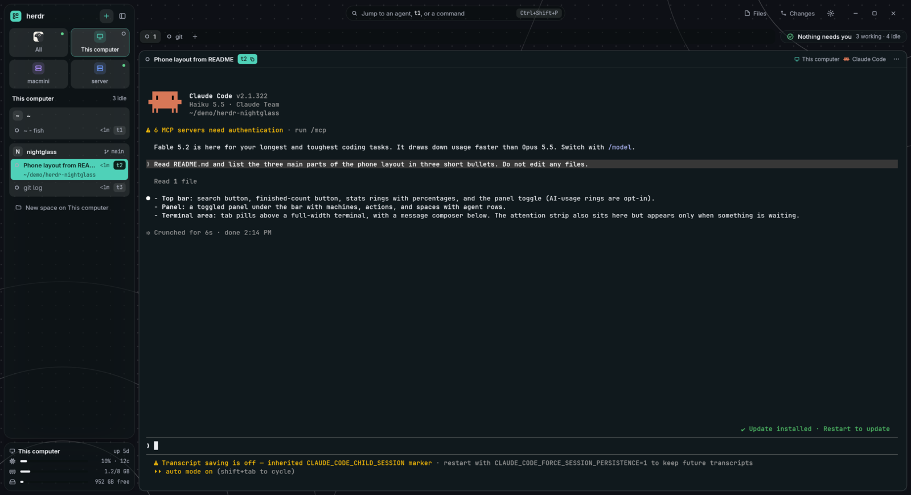

# Nightglass

A dark "glass" Herdr window for people who run agents on several machines. A wallpaper (near-black `#0e1016` with faint dot grid, three arcs and a diagonal line, 2560x1600) sits behind everything; the sidebar, status strip and pane headers are half-transparent glass boxes over it, the terminal is 82% opaque, and the whole window is tinted by the colour you gave the machine you are looking at. The left sidebar lists machines, their spaces and every agent with its status; a strip above the terminal says what needs you.

## What you see

Window: `titlebar: none`, 8 px padding and 8 px gaps everywhere, wallpaper `mods/nightglass/wallpaper.png` (`cover`). UI font Inter, terminal font JetBrains Mono, size 13 (neither is bundled). Terminal padding 14 px vertical, 22 px horizontal, terminal opacity 0.82. Base theme `nightglass`: canvas `#0e1016`, chrome `#0c0d12`, surface `#0d0e13`, text `#eceef2`, muted `#a8adba`, accent `#e6e7eb`, working/done `#5fd38d`, blocked `#f0708a`, amber `#e0af68`, teal `#4fd1b8`.

Left to right:

1. **Sidebar**, 268 px (resizable 56 to 480), two floating glass boxes (fill `#0c0d12` at 50%, 16 px radius, 1 px rim, shadow) with an 8 px gap.
   - Top box: a 28 px brand row (22 px accent square with the logo, "herdr" 14 px semibold, a `+` button, a collapse button); machine tiles, 58 px high, "All" first then one per machine, at most 3 per row and spread evenly (4 tiles make 2 x 2), each with a 24 px icon (monitor for "This computer", server otherwise), its name at 11 px and a status light in the corner; below, a scrolling list for the open machine: a title row (name and a summary such as `2 working · 1 idle`), one capsule per space (28 px header with a 20 px initial, name, git branch in 10.5 px mono) and inside each capsule one row per terminal (30 px; 42 px when it is the focused row and has a "now" line). A row shows a status mark, the title, elapsed time (`<1m`, `12m`, `1h05m`, `2d3h`), and a terminal-number chip (`t3`). Last in the list: "New space on <machine>".
   - Bottom box (the dock): the open machine's name with `ssh` and uptime (`up 3d`), then three 16 px bars, cpu (`37% · 8c`), ram (`20.3/63 GB`), disk (`881 GB free`), bar fill white, amber from 60%, red from 85%.
   - Under 160 px wide the sidebar becomes a rail: logo, `+`, an All button and one 40 px button per machine, and an expand button.
2. **Work column**, top to bottom:
   - Header, 38 px, window-drag area: a search pill centred on the window (30 px high, 15 px radius, max 440 px) reading `Jump to an agent, t1, or a command` with the palette's key label on its right; on the right a Files button, a Changes button (amber `+N` when the focused folder has N changed files), a settings icon (28 px) and, only when the window has its own buttons, minimise, maximise and close (30 x 28 px, close turns red on hover).
   - Strip: a 40 px tab row (a 30 px well of tab pills, 26 px high, with a `+` button; on the right a status capsule, "Nothing needs you  N working · M idle", or "Needs you" and "Done" with red and green counts). When agents wait or have finished, a glass "Needs you / Done" box adds cards in two columns (76 px high, at most 6, "+N more" beyond that); when a machine is unreachable a 44 px amber banner ("<name> is unreachable"). The block resizes itself to fit.
   - Main: the terminal pane (12 px radius, 1 px border, `#ffffff40` focus border) with a 34 px header, and, at the right, a 368 px column (280 to 900) that is hidden until you open Files or Changes.

Machine colours (eight schemes, each a theme): Blue `#6e9bff`, Frost `#52c6f0`, Teal `#4fd1b8`, Forest `#86d46a`, Dune `#e5b45c`, Ember `#f58f5c`, Rose `#f0708a`, Aurora `#a98bf5`. A machine with no pick is Blue. The All view uses the neutral `nightglass-storm`.

## How it behaves

Status marks (10 px slot) on rows, tabs and cards:
- waiting (the agent is blocked on you): 7 px red `#f0708a` square, pulsing opacity 0.3 to 1 every 1 s; its row has a 20% red fill; its space capsule turns red-tinted with a red outline.
- working: 6 px green dot pulsing 0.35 to 1 every 2 s.
- done: green check.
- idle: 8 px hollow ring in the muted colour.
- offline machine: a 7 x 2 px bar, the tile at 62% opacity, a wifi-off icon, "last seen 4m" on its capsules, a banner in the strip.

Clicks and hovers:
- Click a machine tile: shows that machine's spaces and selects the space last visited there (or the empty view "No spaces on <machine>" with a "New space" button). Click All: a card per machine (tinted in its colour) with all its spaces. Right-click a tile: a popup of the eight colour swatches; the pick is stored under the shared key `nightglass.colors`.
- Focused row: solid machine colour, dark text, semibold. Click a row: `agent.focus` for agents, otherwise `space.select`, `tab.select`, `pane.focus`. Right-click a row: the shipped `menu` popup for that pane. Hover a row: a 30 px red strip slides in (after 350 ms) that runs `pane.close` (or `terminal.kill`); hovering a space header slides in the same strip for `space.close`.
- The window takes the focused space's machine theme (checked every 500 ms, `app.theme`). Focus moving to another machine (through a card or the palette) switches the sidebar to it.
- `+` opens a popup listing each connected machine with New space (`space.new`), New terminal tab (`tab.new`) and Agent, whose flyout lists the agents installed on that machine (`tab.new` or `space.new` with that agent's argv). The collapse button runs `layout.resize` sidebar to 56 px, expand to 268.
- Strip cards: click opens the agent (`agent.focus`); waiting cards first, then by time. The status capsule counts waiting and done agents. Tab pills: click `tab.select`; hover shows an x (`tab.close`); `+` is `tab.new`.
- Header: the search pill runs `app.palette`; Files and Changes toggle the right column (clicking the active one hides it, `layout.select` + `layout.show` / `layout.hide`). Which one is open is remembered per space. The settings icon runs `app.settings`.
- Pane header: status mark, title, a chip with the terminal number in the machine colour (click copies it with `wl-copy`, `xclip` or `clip.exe`), machine name, program icon and name, and a `...` button opening the shipped `menu` popup.
- Stats: for the open machine only, while the sidebar is 160 px or wider; every 15 s (a first read within 3 s; 60 s retry after a failure); until the first answer the dock says "reading..." and after a failure "stats unavailable".
- Usage (off unless enabled, see Watch out): one 34 px well per tool with 22 px double rings (outer = weekly, accent colour; inner = 5-hour, teal `#4fd1b8`; amber from 60%, red from 85%); click expands a list of accounts (62 px rows, 30 px rings, reset times) above the wells.

## Built from

`layouts/nightglass.json`: a root row with keys `toast: "nightglass-toast"`, `theme: "nightglass"`, `background`, `padding: 8`, `gap: 8`, `terminal_padding: [14, 22]`, `terminal_opacity: 0.82`, `traffic_lights: [20, 22]`, `preview: "layouts/nightglass.svg"`, `ui_font`, `font`, `font_size`. Children: block `sidebar` (268 px, min 56, max 480, mod `nightglass`, `props.role: "sidebar"`) and a column `work` (not resizable) of: block `header` (38 px, `window_drag`, role `header`), block `strip` (40 px, role `strip`), and a row `work-body` with a stack `main-stack` (active `main`; block `main` shows `tab: active` with pane options gap 8, radius 12, background `surface`, `lone`, 1 px `border`, focus 1 px `#ffffff40`, pane header from role `pane`, 34 px, `reveal: always`; block `empty`, role `empty`) and a hidden column `panel` (368 px) holding stack `panel-body` (active `files`) with blocks `files` and `changes`.

`mods/nightglass/` (one mod, `place: none`, roles by `props.role`): `main.js` (state, polling, machine themes), `sidebar.js` (roles `sidebar`, `newmenu`, `agentmenu`, `spaces`, `colors`), `header.js` (role `header`, usage widget), `strip.js` (roles `strip`, `pane`, `empty`), `lib.js` (tokens, icons, status marks), `data.js` (live data and stats), about 40 SVG icons, 20 + 20 ring arcs (`ring-w-5..100.svg`, `ring-h-5..100.svg`) and `ring-track.svg`, `herdr.png`, `wallpaper.png`.

`mods/nightglass-toast/`: replaces the shipped `toast` mod through the root `toast` key; on this layout it draws the stock look (340 x 72 px box, `popover` fill, status dot, title 13 px semibold, body 12 px muted; click runs the action and closes). Its phone capsule only appears when the layout has a `drawer` node.

`themes/nightglass.json`, `nightglass-{blue,frost,lagoon,forest,dune,ember,sakura,aurora,storm}.json`: all ten are used.

Shipped mods used, not bundled: `files`, `changes` (the right column) and `menu` (right-click and `...` popups).

`herdr` calls: `props`, `shared`/`setShared`, `snapshot` data from `spaces`, `panes`, `machines`, `terminals`, `agents`, `focused`, `layout`, `theme`, `keys`, `window`, `home`, `knownAgents`, `setAgentOrder`, `openOverlay`/`closeOverlay`, `exec`. Commands: `agent.focus`, `space.select`, `space.new`, `space.close`, `tab.select`, `tab.new`, `tab.close`, `pane.focus`, `pane.close`, `terminal.kill`, `layout.select`, `layout.show`, `layout.hide`, `layout.resize`, `app.theme`, `app.palette`, `app.settings`, `window.minimize`, `window.maximize`, `window.close`.

Programs it runs (`exec`): `git --no-optional-locks status --porcelain` in the focused terminal's folder on its machine (every 2 s tick, at most every 10 s per folder); a `sh -c` script reading `/proc/stat`, `/proc/meminfo`, `df -kP /`, `/proc/uptime` and `nproc` on the open machine (Linux only); `sh -c` with `wl-copy`, `xclip` or `clip.exe` to copy a terminal number; and, only with the usage prop, `"$HOME/.local/bin/ai-usage-tui" --json`.

## Watch out

- Needs herdr-app 0.1.16 or newer (root keys `toast` and `preview`). `layout-cycle` is not part of this folder.
- Run `herdr-app check` on `nightglass` and `nightglass-toast`, then `layout.switch {name: "nightglass"}`.
- Tell the person before installing: the mod runs programs (`exec`: git, sh, wl-copy / xclip / clip.exe, and with usage `ai-usage-tui`) on this computer and on every connected machine. It does not use the network itself.
- It reads outside its own folder: Herdr's live state (spaces, terminals, machines), the person's key bindings (`keys()`) for the palette hint, the files of the folders it runs git in, `/proc` on machines, and, with usage on, `icons/claude.svg` and `icons/codex.svg` in the Herdr home (not part of this folder; without them the usage tool icons draw blank). It stores `open`, `visited`, `panels`, `usageOpen` in localStorage and `nightglass.colors`, `nightglass.empty`, `nightglass.usage`, `new-menu.agents` as shared state.
- It changes the app theme: `app.theme` is run whenever the focused machine's scheme changes, so the person's saved theme setting ends up one of the `nightglass*` themes. All ten theme files must be installed.
- Usage is off by default. Add a `usage` prop to the sidebar block's props: `"props": { "role": "sidebar", "usage": "server" }` polls `~/.local/bin/ai-usage-tui --json` on the machine named `server` every 120 s (20 s until the first answer; that tool calls the Anthropic usage endpoints) and shows the usage wells and list above the stats; `"usage": true` means `USAGE_MACHINE` in `data.js`, which is `"amal-build"`, so name the machine instead. The machine must be connected and `ai-usage-tui` installed there. Without the prop nothing is polled and the dock is only the stats.
- Stats need `/proc` and `nproc` (Linux machines); elsewhere the dock says "stats unavailable".
- The wallpaper is referenced as `mods/nightglass/wallpaper.png`; renaming the mod folder breaks it, as do the icon paths (`mods/nightglass/...` in `lib.js`). The ring arcs are pre-drawn in 5% steps.
- Popups (New, agents, spaces, colours) are filled at 50% glass and the app draws no backdrop blur behind overlays, so they are see-through.
- The sidebar measures its own width; under zoom the measured size can differ from layout px, so tiles and bars are sized by flex, not measured widths.
- The strip block resizes itself with `layout.resize` (at most every 2 s); a layout that fixes its size fights it.
- The mod does not bind keys and ships no `keys.json`.
- Two files are copied verbatim into the phone layout's mod (`lib.js`, `data.js`); this folder does not include the phone layout.

## Done when

- `herdr-app check` passes for `nightglass` and `nightglass-toast`, and `layout.switch {name: "nightglass"}` shows a 268 px sidebar, a 38 px header, a 40 px strip and the terminal over the wallpaper.
- The sidebar lists All and every connected machine; clicking a machine lists its spaces and agent rows; a waiting agent's row pulses red and the strip shows a "Needs you" card for it, and clicking the card focuses that agent.
- Right-clicking a machine tile and picking a swatch re-tints the whole window.
- Files and Changes open the 368 px right column; Changes shows `+N` when the focused folder has uncommitted files.
- The dock shows cpu, ram and disk bars for a Linux machine within a few seconds.
- The collapse button turns the sidebar into the 56 px rail and expand brings it back.
- With no `usage` prop, no `ai-usage-tui` process is started and no usage wells show; with `"usage": "<machine>"` they appear once that machine answers.
- A notification shows the stock-looking toast through `nightglass-toast`.
